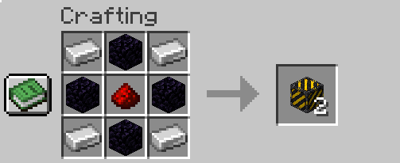

  

# BorderControl

BorderControl is a Minecraft mod built for Forge 1.20.1. This mod adds the ability to restrict your areas to certain players, or nobody at all.

# Making the Border Block

You can craft the border block in survival mode with the following recipe.

If you don't want to keep looking at this repo for the recipe, you can also install Just Enough Items (JEI).

To craft this, **you need 4 obsidian, 4 iron ingots, and 1 redstone dust.**

